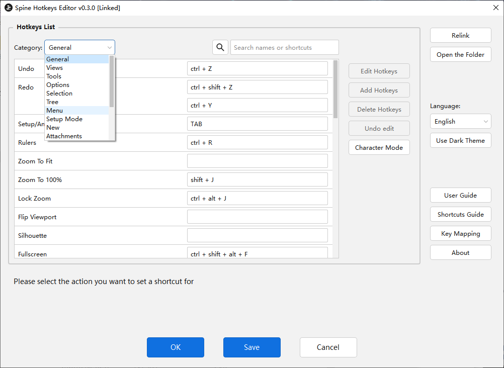

<div align="center">


<br />

# Spine Hotkeys Editor

</div>

<br />
<br />

[简体中文](README.md) | **English**

Spine Hotkeys Editor is a GUI tool for editing Spine shortcuts, developed with PySide6. It aims to replace Spine's extremely primitive method of shortcut customization.

<br />

# Features

- **Visual Shortcut Editing**
- **Search Across Categories by Command Name or Key Combination**
- **Step-by-Step Undo**
- **Shortcut Conflict Detection**
- **Integrated Dual Input Modes**
- **Multi-language Support**
- **Light and Dark Theme Switching**
- **Path Linking and Temporary Backup**

<br />

# Screenshots

<div align="center">

</div>

<br />

# Run

#### Run by executing the Python code

```shell
pip install -r requirements.txt
python main.py
```

#### Build on Windows

Run the following commands in the project root. The build output is located at `dist/Spine Hotkeys Editor.exe`.

```powershell
python -m pip install -r requirements.txt
python -m PyInstaller Spine_Hotkeys_Editor.spec
```

#### Support this software via the links below

- **[Afdian → 6CNY](https://afdian.com/item/848b53def54411f0b8845254001e7c00)**
- **[BOOTH → 240JPY](https://vosaa2a3.booth.pm/items/7895722)**

 **(Special note: Due to regional restrictions and other reasons, I am temporarily unable to provide sponsorship channels on platforms such as "Buy Me a Coffee")**

 **(Special note: These links are purely for sponsorship support. The software obtained after sponsoring is an older version; please download the latest build from GitHub)**

<br />

# Usage Instructions

#### Core Usage Guide

1. **Link the shortcut file**: On first launch, click the "Link" button and select the Spine shortcut file. `hotkeys-1.txt (v4.0+)`
2. **Select the input mode**: Click "Character Mode" to activate Character Mode, or switch back to the general input mode.
3. **Edit shortcuts**: Select an entry to edit it.
4. **View instructions**: Click the corresponding button on the right to view the User Guide, Shortcuts Guide, Key Mapping, and About.
5. **Save changes and reload**: After clicking "OK" in the main window, restart Spine or reload the shortcuts in the Spine editor settings.

#### Other Operation Instructions

- **Backup**: Click the "Open the Folder" button to open the path of the linked file and back up the shortcut file.
- **Restore the shortcut before editing**: Replace Spine's shortcut file with the one in the `./processing/` directory.
- **Restore default shortcuts**: Delete the shortcut file or click "Restore Default" in the Spine editor settings.
- **Switch languages**: Select the corresponding language from the dropdown on the right. Ensure the corresponding language pack exists and is enabled in the configuration.
- **Switch themes**: Click the button below the language selector to switch themes.
- **Find and undo**: Use `Ctrl + F` or the search field to find shortcuts; click the button or press `Ctrl + Shift + F` to capture a shortcut for the search. Click "Undo edit" or press `Ctrl + Z` to undo the previous edit.

<br />

# Shortcuts Guide

- In General Mode, hotkey combinations can use modifier keys such as "Ctrl", "Shift", and "Alt".
- In Character Mode (Single-quote Mode), only the "Alt" modifier key can be used in hotkey combinations.
- When using Character Mode, hotkeys gain long-press functionality: after an initial trigger and a short delay, the action will repeat continuously.
- Character Mode accepts single typable characters ('a'、'ア'、'啊'、'↓'). Some characters have corresponding keywords.
- Special characters not present on a standard keyboard require key mapping in Single-quote Mode; please avoid entering unexpected or unsupported characters.

<br />

# Compatibility

The GUI program works by parsing the structure of Spine shortcut files and performing data conversion. Therefore, its functionality theoretically covers shortcut files for all current versions of Spine.

Displayed text uses corresponding values from the language pack. Since shortcuts vary across different Spine versions, some shortcut names are not recorded in the language pack, and in such cases, the original name is displayed.

Because shortcuts are mostly added along with version updates, the language packs currently provided are made using the shortcut file from the latest version of Spine. The current version is `Spine 4.3.26`.

<br />

# Changelog

[Changelog_Chinese](CHANGELOG.md)

<br />

# Planned Updates

 **Features**：
 - Export: Quickly export shortcuts as images or tables.

<br />

# Other instructions

- Development Motivation：70% plenty of free time(long-term unemployment), 20% frustration with Spine's extremely primitive shortcut editing method, 9% as the final act of cutting ties with 2D animation production, **100‰ for contributing to the community**.
- Development Direction：Overall reference to Live2D's shortcut GUI modification logic and layout.
- Special Note：I am not a professional software developer. Code, configuration, and program logic design may be unreasonable, non-standard, or non-standardized. Feature additions, code improvements, and project optimizations will be left to future contributors (though I still hope the official team would write one).
- Special Note: I do not know English. The default English documentation is machine-translated. English localization optimization is needed.
- Special Note: This program is only compatible with standard US keyboards.
- Special Note: The issues related to the 'PLUS' shortcut keyword have already been fixed by the official team.
- Special Note: The current program's preprocessing stage cannot exclude all unexpected shortcuts (i.e., syntactically valid but with invalid keys or unrecognizable by the Spine editor).
- Special Note: Due to Windows limitations, `Shift + NUMPAD_(0~9/.)` is always converted to navigation keys regardless of the `NumLock` state. This is a system-level restriction. Spine, unlike software such as After Effects (AE), does not implement low-level system hooks and thus cannot recognize the navigation keys on the numpad. Therefore, if you need to force the input, you must modify the system-wide key mapping. This can be done by binding key remappings using tools like AutoHotkey or PowerToys. However, in this scenario, only the right Shift key (RShift) can be registered, while the left Shift key (LShift) will be blocked. For smoother usage, it is recommended to avoid hotkeys in the `Shift + NUMPAD_(0~9/.)` series.
- Special note: Spine editor allows shortcut key conflicts for certain operation commands (e.g., conflicts between shortcuts for editing mesh series and other shortcuts will not trigger warnings). In actual use, conflicting hotkeys can be executed, but this may result in multiple commands being triggered simultaneously or only the high-priority shortcut being triggered. However, this program's rules will still classify it as a conflict item.

<br />

# Contributions

Code contributions and additional localized language packs are welcome.

#### Areas for Improvement:

1. **Features**:

   - Integrate import, export, reset functions into the program.
   - Test and adapt support for more input devices (e.g., software control panels like TourBox, game controllers, etc.).
2. **Aesthetics**:

   - Implement a custom title bar with visual feedback for link status.
3. **Internationalization**:

   - Fix potential machine-translation errors in the English language pack.
   - Expand shortcut description texts (`[KeyName].note`).
   - Add more internationalized language packs.

<br />

# Support

If this project is helpful to you, please feel free to share it.

you can support it by **[sponsoring on Afdian](https://afdian.com/a/VOSAA2A3)** or **[via Bilibili charging](https://space.bilibili.com/23488880)**. I'd be happy if you could treat me to a cup of milk tea.

You can follow my Bilibili account, where I will post my works and tutorials.

Link: [https://space.bilibili.com/23488880](https://space.bilibili.com/23488880)

<br />

# License

This project is open-sourced under the [MIT](LICENSE) license.
